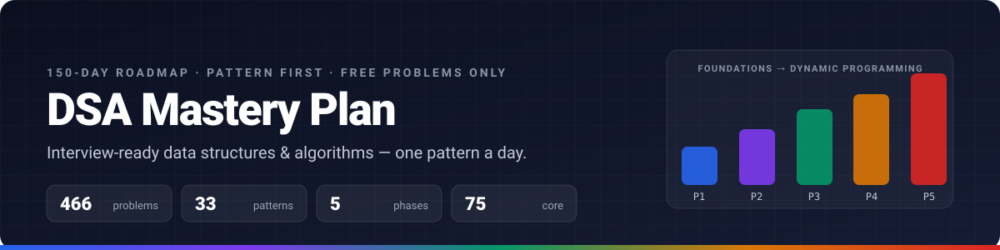
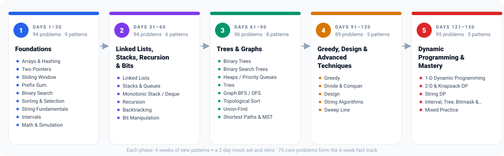

<p align="center">
  <a href="https://ranjithrosan17.github.io/dsa-mastery-plan-2026/"></a>
</p>

<h1 align="center">DSA Mastery Plan — 150 Days</h1>

<p align="center">
  A pattern-first roadmap to data structures &amp; algorithms for coding interviews:<br>
  <b>one dataset, five phases, 33 playbooks, 460+ verified free LeetCode problems</b> and a tracker that runs in your browser.
</p>

<p align="center">
<!-- generated:badges:start -->
  <a href="https://ranjithrosan17.github.io/dsa-mastery-plan-2026/"></a>
  <a href="https://github.com/RANJITHROSAN17/dsa-mastery-plan-2026/actions/workflows/ci.yml"></a>
  <a href="PROBLEMS.md"></a>
  <a href="PATTERNS.md"></a>
  <a href="LICENSE"></a>
  <a href="CONTRIBUTING.md"></a>
<!-- generated:badges:end -->
</p>

<p align="center">
  <a href="https://ranjithrosan17.github.io/dsa-mastery-plan-2026/">Open the tracker</a> ·
  <a href="curriculum/README.md">Curriculum</a> ·
  <a href="PROBLEMS.md">All problems</a> ·
  <a href="PATTERNS.md">Pattern playbooks</a> ·
  <a href="#fast-track-6-weeks">Fast track</a> ·
  <a href="#faq">FAQ</a>
</p>

---

## Why this plan

- **Every problem is real and free.** All 466 problems were checked against LeetCode's problem index — no premium questions, no dead links, no made-up titles.
- **Patterns first, problems second.** Each day teaches one of 33 patterns (sliding window, monotonic stack, union-find, interval DP, …) and drills it with 2–5 problems. Recognising the pattern is the skill interviews test.
- **One source of truth.** The whole plan lives in [`data/curriculum.json`](data/curriculum.json). The tracker, the per-phase docs, the problem tables and the playbook lists are all generated from it, and CI fails if they drift.
- **A tracker you own.** Checkboxes, notes, streaks and a fast-track toggle — stored in your browser, exportable as JSON, no account, no backend. Works offline from a local clone.
- **Fast track built in.** 75 ⭐ core problems (the Blind-75 lineage) are flagged for people with six weeks instead of five months.
- **Verified learning resources.** Pattern resources link to cp-algorithms, USACO Guide, Tech Interview Handbook and verified YouTube playlists — every URL was checked when it was added.

<p align="center"></p>

## The five phases

<!-- generated:phases:start -->
| Phase | Days | What you learn | Problems | Docs |
|---|---|---|---:|---|
| **1. Foundations** | 1–30 | Complexity analysis, arrays, hashing, two pointers, sliding window, prefix sums, binary search, sorting, strings, intervals. | 94 | [open](curriculum/phase-1-foundations.md) |
| **2. Linked Lists, Stacks, Recursion & Bits** | 31–60 | Pointer manipulation, stack/queue machinery, monotonic stacks, recursion and backtracking, bit tricks and math. | 94 | [open](curriculum/phase-2-linked-lists-stacks-recursion-bits.md) |
| **3. Trees & Graphs** | 61–90 | Binary trees and BSTs, heaps, tries, BFS/DFS, topological sort, union-find, shortest paths and MSTs. | 96 | [open](curriculum/phase-3-trees-graphs.md) |
| **4. Greedy, Design & Advanced Techniques** | 91–120 | Greedy proofs, intervals, monotonic deques, divide & conquer, design problems, string algorithms, sweep line. | 89 | [open](curriculum/phase-4-greedy-design-advanced-techniques.md) |
| **5. Dynamic Programming & Mastery** | 121–150 | 1-D, 2-D, knapsack, string, interval, tree, bitmask and digit DP, then two weeks of mixed timed mocks. | 96 | [open](curriculum/phase-5-dynamic-programming-mastery.md) |
<!-- generated:phases:end -->

Each phase is four 7-day weeks plus a two-day **mock set + retro**. Review days re-solve earlier problems under time pressure; mock days mix patterns the way interviews do.

### Patterns by phase

<!-- generated:patterns:start -->
| Phase | Patterns |
|---|---|
| 1. Foundations | [Arrays & Hashing](patterns/arrays-hashing.md) · [Two Pointers](patterns/two-pointers.md) · [Sliding Window](patterns/sliding-window.md) · [Prefix Sum](patterns/prefix-sum.md) · [Binary Search](patterns/binary-search.md) · [Sorting & Selection](patterns/sorting.md) · [String Fundamentals](patterns/strings.md) · [Intervals](patterns/intervals.md) · [Math & Simulation](patterns/math-geometry.md) |
| 2. Linked Lists, Stacks, Recursion & Bits | [Linked Lists](patterns/linked-list.md) · [Stacks & Queues](patterns/stack.md) · [Monotonic Stack / Deque](patterns/monotonic-stack.md) · [Recursion](patterns/recursion.md) · [Backtracking](patterns/backtracking.md) · [Bit Manipulation](patterns/bit-manipulation.md) |
| 3. Trees & Graphs | [Binary Trees](patterns/trees.md) · [Binary Search Trees](patterns/bst.md) · [Heaps / Priority Queues](patterns/heap.md) · [Tries](patterns/trie.md) · [Graph BFS / DFS](patterns/graph-traversal.md) · [Topological Sort](patterns/topological-sort.md) · [Union-Find](patterns/union-find.md) · [Shortest Paths & MST](patterns/shortest-paths.md) |
| 4. Greedy, Design & Advanced Techniques | [Greedy](patterns/greedy.md) · [Divide & Conquer](patterns/divide-conquer.md) · [Design](patterns/design.md) · [String Algorithms](patterns/string-algorithms.md) · [Sweep Line](patterns/sweep-line.md) |
| 5. Dynamic Programming & Mastery | [1-D Dynamic Programming](patterns/dp-1d.md) · [2-D & Knapsack DP](patterns/dp-2d.md) · [String DP](patterns/dp-strings.md) · [Interval, Tree, Bitmask & Digit DP](patterns/dp-advanced.md) · [Mixed Practice](patterns/mixed.md) |
<!-- generated:patterns:end -->

Every playbook in [`patterns/`](patterns) has the same shape: *when to use it · recognise it · Python template · complexity · pitfalls · how to talk about it · problems from the plan · resources*.

### By the numbers

<!-- generated:numbers:start -->
**466** unique LeetCode problems (all free) · **80** easy / **291** medium / **95** hard · **33** patterns · **75** ⭐ core problems · **18** ▶ verified video walkthroughs · dataset v2.0.0, updated 2026-10-24
<!-- generated:numbers:end -->

## How to use it

### Daily (60–120 minutes)

1. Open the [tracker](https://ranjithrosan17.github.io/dsa-mastery-plan-2026/) and press <kbd>n</kbd> — it jumps to your next day.
2. Read the day's **goal** and **learn / do** items, then skim the linked pattern playbook (10–15 min).
3. Solve the problems **without hints first** (25–35 min each for mediums). Stuck for 20 minutes? Read the approach, close it, re-implement from memory.
4. Tick each problem, write two lines in the **notes** box (what clicked, what fooled you), and mark the day complete.
5. Finish with a 5-minute re-explanation of today's pattern out loud.

### Weekly

- Days 1–6 of each week are new material; use day 7 to **re-solve** the week's hardest two problems from a blank editor.
- At each phase's end, do the **mock set** on a 90-minute clock, then write a short retro in [`postmortems/`](postmortems).
- Patterns you failed twice go into your own spaced-repetition list (the notes field is enough).

### Fast track (6 weeks)

Tick **Fast track** on the tracker's home page. Only the 75 ⭐ core problems stay visible, the per-phase progress recalculates, and the daily order is preserved so you still move through the phases in sequence. Finished the fast track? Turn it off and the remaining problems are waiting where you left them.

### Use it offline / in your own fork

```bash
git clone https://github.com/RANJITHROSAN17/dsa-mastery-plan-2026.git
cd dsa-mastery-plan-2026
open index.html          # or double-click it — no server, no build step
```

Fork it to keep your own notes in [`logs/`](logs), export your progress JSON from **Stats → Backup** and commit it, or edit `data/curriculum.json` to make the plan yours — then run `python3 scripts/build.py` to regenerate everything.

## A sample day

<!-- generated:sample:start -->
> **Day 12 — Variable-size sliding window** · Phase 1 · Sliding Window
>
> **Goal:** Expand right, shrink left while an invariant is violated.
>
> | Problem | Difficulty |
> |---|---|
> | [3. Longest Substring Without Repeating Characters](https://leetcode.com/problems/longest-substring-without-repeating-characters/) ⭐ | 🟡 Medium |
> | [209. Minimum Size Subarray Sum](https://leetcode.com/problems/minimum-size-subarray-sum/) | 🟡 Medium |
> | [424. Longest Repeating Character Replacement](https://leetcode.com/problems/longest-repeating-character-replacement/) ⭐ | 🟡 Medium |
<!-- generated:sample:end -->

Browse every day in [`curriculum/`](curriculum/README.md) or on the tracker.

## Repository structure

| Path | What it is |
|---|---|
| [`data/curriculum.json`](data/curriculum.json) | **The plan.** 150 days, patterns, phases, problems, resources. Edit this. |
| [`scripts/build.py`](scripts/build.py) | Validates the data and generates everything below. `--check` is what CI runs. |
| [`index.html`](index.html) · [`assets/`](assets) | The tracker (vanilla HTML/CSS/JS) and the generated `curriculum.data.js` bundle. |
| [`curriculum/`](curriculum) | Generated per-phase documents — every day, goal, learning item and problem. |
| [`PROBLEMS.md`](PROBLEMS.md) · [`PATTERNS.md`](PATTERNS.md) | Generated indexes of all problems and all patterns. |
| [`patterns/`](patterns) | 33 hand-written playbooks with generated problem lists. |
| [`logs/`](logs) · [`postmortems/`](postmortems) | Templates for your daily log and phase retros. |
| [`LEARNING-RESOURCES.md`](LEARNING-RESOURCES.md) | Curated, link-checked courses, books, sites and channels. |

More detail in [REPOSITORY-STRUCTURE.md](REPOSITORY-STRUCTURE.md) and [GETTING-STARTED.md](GETTING-STARTED.md).

## Contributing

Found a better problem for a day, a broken link, or a clearer template? Edit `data/curriculum.json` or the playbook, run `python3 scripts/build.py`, and open a pull request — see [CONTRIBUTING.md](CONTRIBUTING.md). Problems must be free on LeetCode; resources must be publicly accessible.

## FAQ

**Is 150 days realistic?** It is a pace of 2–5 problems a day. People with more time compress the first two phases; people with less time use the fast track or do each phase over six weeks instead of four. The plan is a sequence, not a calendar.

**Why LeetCode only?** Interviews draw from the same pool, and a single source keeps every problem verifiable. Each pattern's resources point to deeper theory (cp-algorithms, USACO Guide) when you want it.

**Which language?** Templates are Python for readability; nothing in the plan is language-specific.

**Can I reorder things?** Yes — the data file is meant to be edited. Keep `day` numbers contiguous and run the build; validation will tell you if something is off.

**Where is my progress stored?** In your browser's `localStorage` only. Export it from *Stats → Backup* before clearing site data or switching devices.

## Acknowledgements

The problem selection stands on the shoulders of [NeetCode 150](https://neetcode.io/practice), the original [Blind 75](https://www.techinterviewhandbook.org/grind75/), [Striver's A2Z sheet](https://takeuforward.org/strivers-a2z-dsa-course/strivers-a2z-dsa-course-sheet-2/), [Sean Prashad's LeetCode Patterns](https://seanprashad.com/leetcode-patterns/) and the [Tech Interview Handbook](https://www.techinterviewhandbook.org/). Theory links go to [cp-algorithms](https://cp-algorithms.com/) and the [USACO Guide](https://usaco.guide/). Problems are the property of [LeetCode](https://leetcode.com); this project is not affiliated with it.

## License

[MIT](LICENSE) — use it, fork it, teach with it.
